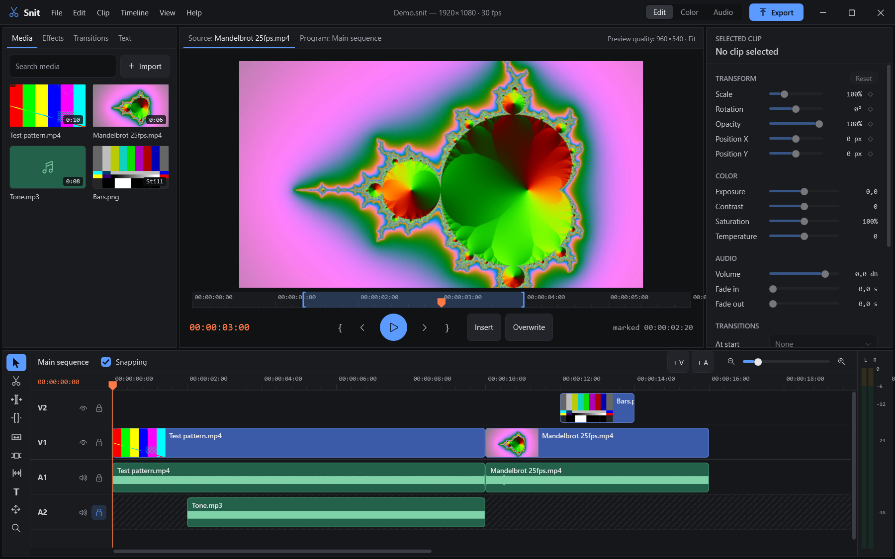

# Snit

[](https://github.com/sennacools/snit-video-editor/actions/workflows/build.yml)

**Snit** is a small desktop video editor for Windows, in the style of Adobe Premiere.
It's built with C#, WPF and FFmpeg.



> **Status:** all six planned phases are in: editing, preview with sound, titles, picture
> effects with keyframes, speed, transitions, and export to six formats. It is still young
> software, so keep your original media files safe.

## What works

- **Import** video, audio and pictures (Import button, Ctrl+I, or drop files on the media bin)
- **Timeline** with as many video and audio tracks as you like ("+ V" / "+ A", right-click a track
  header to delete it): drag media from the bin, move clips (also between tracks), trim edges,
  cut with the razor, delete or ripple-delete, copy/cut/paste, box-select, snapping,
  hide/mute/lock tracks. Videos with sound get a linked audio clip that is edited together with the picture.
- **Editing tools** like Premiere: ripple trim, rolling edit, slip, slide and rate stretch
- **Source monitor**: double-click a file in the bin, mark in/out, then Insert or Overwrite at the playhead
- **Markers** (M) on the ruler, with names; clips snap to them
- **Preview** with sound, frame-accurate scrubbing on the ruler, and frame-by-frame stepping
- **Titles**: add with the T tool, the Text tab or "Add title at playhead"; change the text,
  font, size, colour, bold, shadow and position in the inspector
- **Sound**: waveforms on audio clips, per-clip volume and fade in/out in the inspector,
  and live stereo level meters while playing
- **Picture**: scale, rotation, opacity and position (Transform), exposure, contrast,
  saturation and temperature (Colour) per clip in the inspector; the preview stacks the tracks
  so a smaller or see-through clip on V2 shows V1 underneath
- **Keyframes**: animate scale, rotation, opacity and position with the diamond next to each
  slider; values change evenly between keyframes
- **Speed** from 10% to 400% and **reverse**, for video and its sound together
- **Transitions** (32, in Premiere's groups, with search): Cross / Film / Additive / Non-Additive / Dither
  Dissolve, Dip to Black and White; Iris Round, Box, Diamond, Cross; Wipe, Band Wipe, Barn Doors, Checker
  Wipe, CheckerBoard, Clock Wipe, Gradient Wipe, Inset, Paint Splatter, Pinwheel, Radial Wipe, Random
  Blocks, Random Wipe, Spiral Boxes, Venetian Blinds, Wedge Wipe, Zig-Zag Blocks; Slide and Push; Cross
  Zoom; Flip Over. Wipes and slides have a direction. Drag one onto a cut or a clip edge (Ctrl+D: a cross
  dissolve at the playhead cut); the sound cross-fades along. Each wipe shape is one formula that FFmpeg
  uses for the export and Snit itself works out for the preview, so they match
- **Effects** (64, in Premiere's groups, with search): Adjust (Brightness & Contrast, Levels, Channel
  Mixer, ProcAmp, Auto Contrast / Levels / Color, Extract, Lighting), Blur & Sharpen (Fast, Gaussian,
  Directional, Camera and Channel Blur, Unsharp Mask, Sharpen), Invert, Color Correction (Tint, Leave
  Color, Change Color, Color Balance HLS / RGB, Video Limiter, LUTs), Distort (Mirror, Lens Distortion,
  Spherize, Corner Pin, Wave Warp, Twirl, Offset, Magnify, Turbulent Displace, Warp Stabilizer),
  Generate (Grid, Checkerboard, Ramp, Circle, Lens Flare), Black & White, Gamma, Keying (Ultra Key,
  Color Key, Luma Key, Alpha Adjust), Noise, Median, Dust & Scratches, Drop Shadow, Basic 3D, Stylize
  (Vignette, Emboss, Color Emboss, Find Edges, Mosaic, Posterize, Solarize, Threshold, Strobe Light,
  Replicate), Echo, Posterize Time, Crop, Flips, Edge Feather, and Linear / Radial Wipe, Venetian Blinds
  and Block Dissolve as effects. Drag one onto a clip, then change, switch off or remove it in the inspector
  - Not included (they need things FFmpeg can't do): Morph Cut, Page Peel / Page Turn, Cube Spin, Band
    Slide, Split, the VR effects, Lightning, Cell Pattern, Write-on, Track Matte Key, Roughen Edges
- **Color workspace** (Color button, top right): scopes on the left (waveform, RGB parade,
  vectorscope, histogram) measuring the program picture, and a Lumetri-style panel on the right:
  basic correction with tint, three colour wheels (shadows, midtones, highlights) and RGB curves
- **Audio workspace**: a track mixer on the left (volume fader, balance, mute and solo per sound
  track) and the clip's sound on the right: volume with keyframes, fades, a three-band
  equaliser (bass, voice, treble) and noise reduction
- **Title templates** in the Text tab (title, big title, lower third, chapter, corner tag, caption,
  end credits): drag one onto a video track or double-click it; titles can have a box behind the text
- **Captions**: a C1 track at the top where each clip is one subtitle (Timeline → Add caption at
  playhead). Import and export `.srt` files; the export can burn them into the picture and/or save an `.srt` next to it
- **Sequences**: several timelines in one project (Timeline → New / Rename / Delete sequence, and the
  dropdown above the timeline). **Sequence settings** choose the size (HD, 4K, vertical, square…) and frame rate;
  clips keep their place in time
- **Nested sequences**: select clips and choose Clip → Nest, or drag a sequence from the bin into another one.
  Snit renders a nested sequence to a hidden high-quality file and plays that; when you change it, it is
  rendered again automatically (always before an export)
- **Proxies** for smooth 4K: right-click a video in the bin → Make proxy. The preview plays the small copy
  (View → Use proxies), the export always uses the original
- **In and out marks** (I and O) to export just a part of the timeline
- **Undo / redo** for every timeline edit (one slider drag or one bit of typing is one step)
- **Projects** saved as `.snit` files (plain JSON; media files are referenced, never copied),
  with **auto-save** every two minutes (a separate copy, offered back after a crash) and **Open recent**
- **Export** to MP4 (H.264 or H.265), WebM (VP9), MOV (ProRes 422 HQ), GIF or MP3 at 720p,
  1080p, 4K or vertical 1080×1920, 24–60 fps, the whole timeline or just in-to-out, with a
  quality slider, a progress bar with time left, and a Stop button. H.264/H.265 can use your
  NVIDIA, Intel or AMD graphics card (needs an up-to-date driver).

## Keyboard shortcuts

| Key | Action |
| --- | --- |
| Space | Play / pause |
| J / K / L | Play backwards / stop / play forwards (press again to go faster) |
| ← / → | Previous / next frame |
| ↑ / ↓ | Previous / next cut |
| Home / End | Go to start / end |
| I / O | Mark in / mark out (Ctrl+Shift+X clears both); in the Source monitor: its own marks |
| , / . | Insert / overwrite from the Source monitor |
| M | Add marker (Shift+M next, Ctrl+Shift+M previous) |
| V / C / B / T / H / Z | Select / razor / ripple trim / text / hand / zoom tool |
| N / Y / U / R | Rolling edit / slip / slide / rate stretch tool |
| S | Snapping on / off |
| Delete | Delete selected clips (Shift+Delete: ripple delete) |
| Ctrl+K | Cut clips at the playhead |
| Ctrl+C / Ctrl+X / Ctrl+V | Copy / cut / paste clips (paste goes to the playhead) |
| Ctrl+D | Cross dissolve at the cut nearest the playhead |
| Ctrl+Z / Ctrl+Shift+Z | Undo / redo |
| = / - | Zoom timeline in / out (Ctrl+mouse wheel also zooms) |
| Ctrl+N / Ctrl+O / Ctrl+S | New / open / save project |
| Ctrl+I | Import media |
| Ctrl+M | Export |

## Requirements

- Windows 10 or 11
- [.NET SDK 10](https://dotnet.microsoft.com/download) (only needed to build Snit)
- **FFmpeg** on your PATH. Snit doesn't include FFmpeg. Install it once with:

  ```
  winget install Gyan.FFmpeg
  ```

  If FFmpeg is missing, Snit shows a message with this command and a **Check again** button.

Optional: install the fonts [Inter](https://rsms.me/inter/) and
[JetBrains Mono](https://www.jetbrains.com/lp/mono/). Without them, Snit uses Segoe UI and Consolas.

## Build and run

```
git clone https://github.com/sennacools/snit-video-editor.git
cd snit-video-editor
dotnet run --project src/Snit
```

Or open `Snit.slnx` in Visual Studio 2022 (17.14 or newer) or Rider and press Run.

## Project layout

| Folder | What's in it |
| --- | --- |
| `src/Snit/Views` | The windows and panels (XAML) |
| `src/Snit/ViewModels` | What the screens show and do (MVVM) |
| `src/Snit/Themes` | Colours, fonts and control styles |
| `src/Snit/Controls` | Custom controls (timeline canvas, time ruler, inspector slider) |
| `src/Snit/Services` | FFmpeg: importing, thumbnails, preview playback, project files |
| `src/Snit/Core` | The project model (media, tracks, clips) and editing rules |
| `tests/Snit.Tests` | Automated tests |

## How the preview works

The preview runs `ffmpeg` in the background and reads raw frames from it, already resized to
960×540 and converted to the project frame rate. Playing or stepping forward keeps the same
`ffmpeg` running, so it is fast; jumping somewhere else starts a new one at that exact frame.
Sound is mixed by `ffmpeg` too and played with [NAudio](https://github.com/naudio/NAudio).

Each video track is decoded separately (with the clip's colours already applied by `ffmpeg`)
and the monitor stacks the tracks, applying size, rotation, position and opacity itself.
Tracks hidden behind a full-screen video are skipped. Reversed clips play choppy in the
preview, because every frame has to be looked up on its own; they export smoothly.

## How export works

Snit turns the timeline into a single `ffmpeg` command. Each clip becomes an input cut to the
used part of its file. The pictures are resized to the export size and laid over a black
background at the right times (V2 on top of V1), and all sound clips are delayed to their
place and mixed. `ffmpeg` reports which frame it is on, which drives the progress bar.

Titles are drawn by Snit itself into see-through PNG pictures (the same drawing the preview
shows), which `ffmpeg` lays over the video like any other picture. Clip volume and fades use
the same `ffmpeg` sound recipe in the preview and in the export.

## Tests

```
dotnet test
```

Some tests make tiny test videos with FFmpeg in a temporary folder; they are skipped when FFmpeg
isn't installed.

To refresh the screenshot above: `dotnet run --project src/Snit -- --screenshot docs/screenshot.png`
(you can put a `.snit` file before `--screenshot` to show a project, and `--workspace Color` or
`--workspace Audio` to start in that workspace).
To export a project without opening the dialog: `Snit.exe project.snit --export video.mp4`.

## License

Snit is released under the [MIT License](LICENSE). FFmpeg and NAudio have their own licenses.
